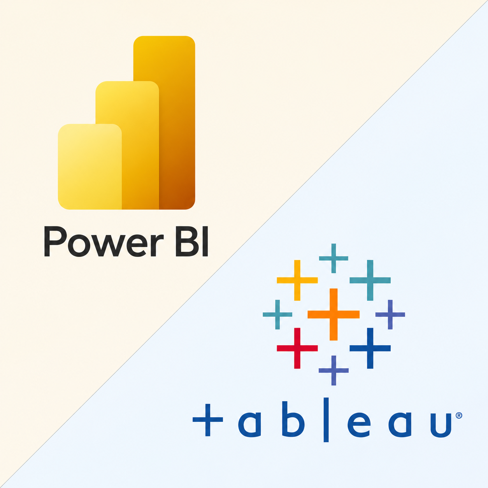

<h2 align="center">Hi, I'm Bohdan.</h2>

I love analytics. Data is not only part of business but of everyday life too, and when used correctly, it can answer a surprising number of questions. That's one of the reasons I'm building a career as a data analyst.

My main tools are SQL, Python, Excel, Power BI and Tableau.

Based in Ukraine, open to remote opportunities. Always open to a conversation, a meeting or a game of chess.

<h1 align="center">Projects</h1>

<table>
<tr>
<td width="75%">
<h3>PigulkaBio: Sales and Profitability Analysis</h3>

PigulkaBio is a fictional pharmaceutical company selling diagnostics, immunobiologics, injectables and other products to distributors in domestic and export markets. The case study uses a synthetic dataset based on real transactions for 2019–2021, including sales, returns and discount adjustments.

The analysis explains why revenue recovered to a period high in 2021 while gross profit stayed below the 2019 level and margin declined every year, breaking the change down by product mix, customer concentration, pricing exceptions and markets.

</td>
<td width="25%">
<a href="https://github.com/N3vrM1nd7/PigulkaBio-Sales-Analysis/blob/main/README.md">
<picture>
<source media="(prefers-color-scheme: dark)" srcset="logo/icon_dark.png" />

</picture>
</a>
</td>
</tr>
</table>

<table>
  <tr>
    <td width="75%">
      <h3>Olist Delivery Operations</h3>
      
Olist is a large Brazilian technology company in the e-commerce sector. The dataset consists of about 100,000 order records from the period between 2016 and 2018, originating from various marketplaces in Brazil.

      
The dashboard covers key metrics that allow the audience to track trends, statistics, and the status of delivery performance, customer reviews, and a range of other indicators.

           
      
    </td>
    <td width="25%">
      
    </td>
  </tr>
</table>
